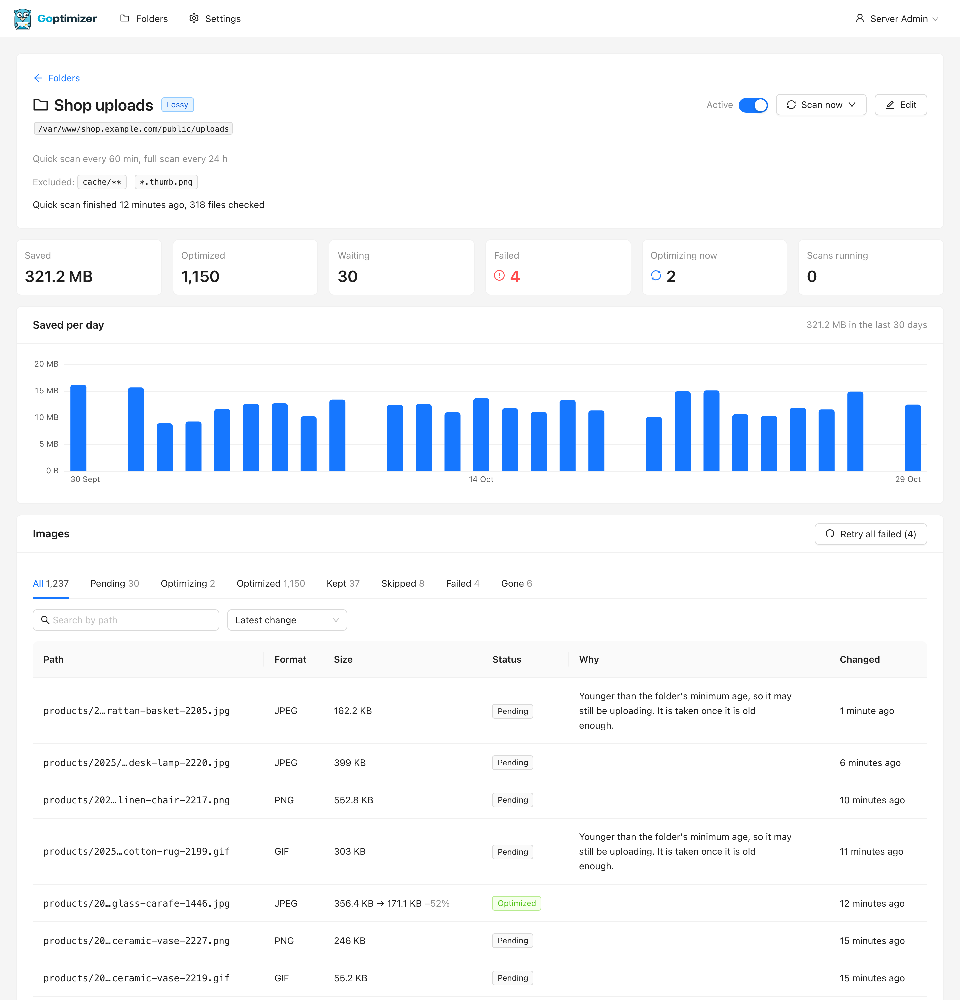
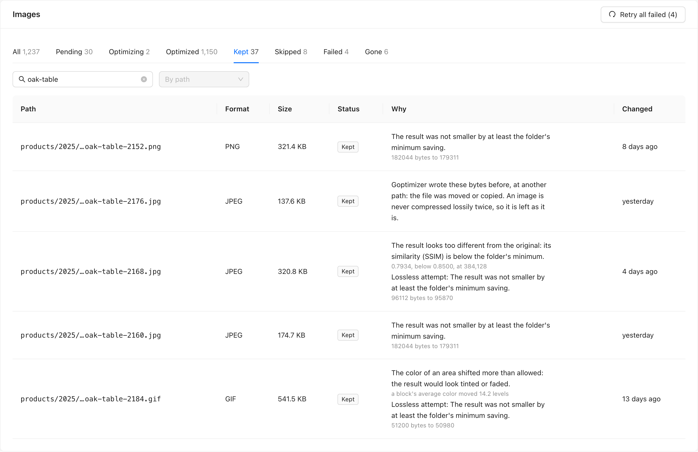
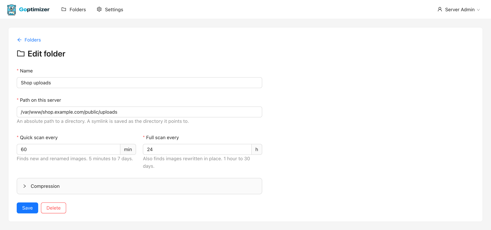
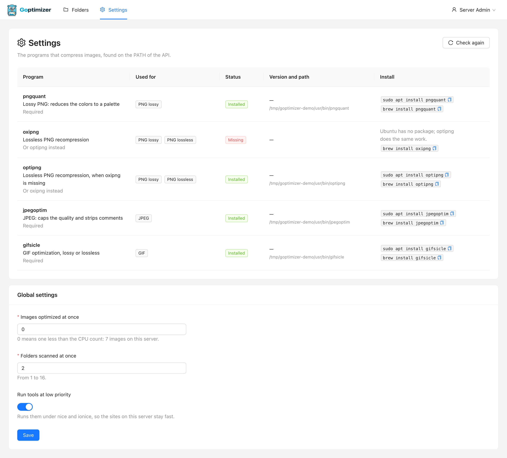
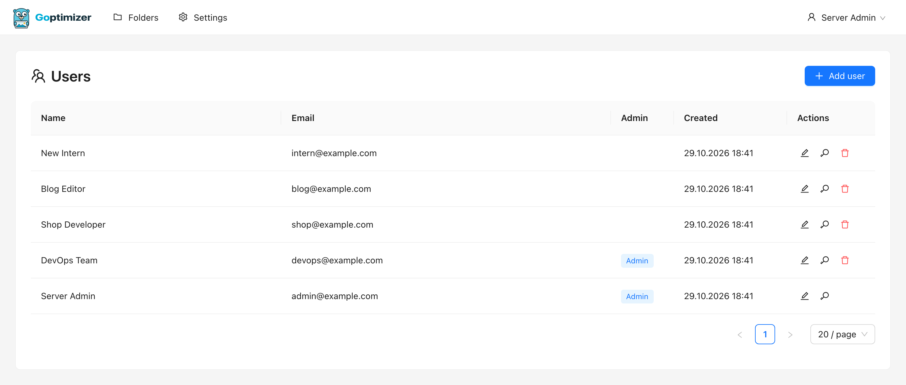
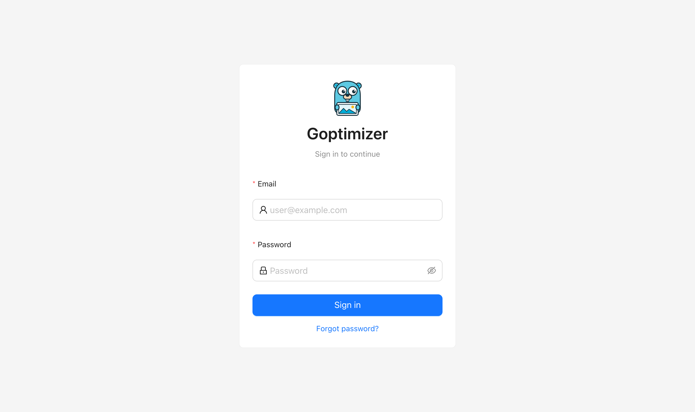
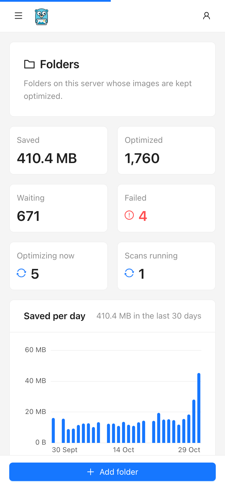
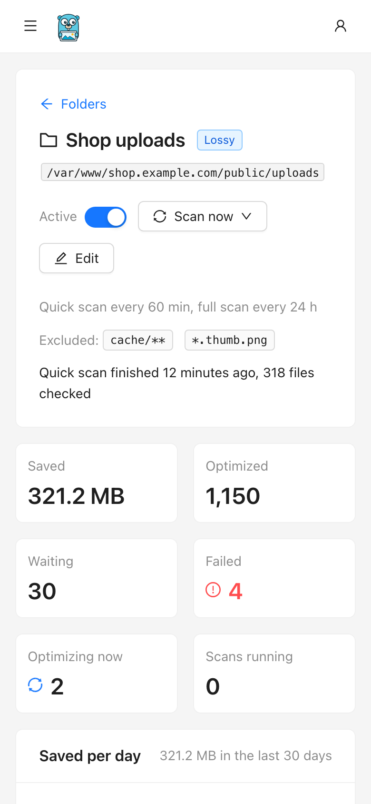

<p align="center">
  <picture>
    <source media="(prefers-color-scheme: dark)" srcset="docs/images/logo-wordmark-dark.svg">
    
  </picture>
</p>

<p align="center">
  Self-hosted image optimization for every project on your server.<br>
  Add a folder, and Goptimizer keeps its images small, TinyPNG-style, on a schedule.
</p>

<p align="center">
  <a href="https://github.com/nicklasos/goptimizer/actions/workflows/ci.yml"></a>
  
  
  
  <a href="LICENSE"></a>
  
</p>

> [!WARNING]
> **Goptimizer is in early development.** It optimizes images in place and keeps no copy of the
> originals. Every result has to pass the checks under [Safety](#safety) first. The checks were tested
> on macOS with Homebrew's builds of the tools, not yet on a Linux server. The deploy playbooks do not
> install the image tools or run the service as root until phase 6, so on a server deployed today it
> can only rewrite files its own user owns. Try it on a copy of a folder first.


## Why

One server often hosts many projects, and each one collects images that nobody optimized: uploads from
users, photos straight from a phone, screenshots, generated thumbnails. A cron job per project with a few
`pngquant` and `jpegoptim` lines works until there are a dozen of them, each slightly different, and no
one knows how much they save or whether they still run.

Goptimizer replaces those scripts with one service and a web page. You add each project's image folder
once. The service finds new and changed images on its own, shrinks them with the best command-line tools
installed on the server, and shows per folder how many images it handled and how many bytes it saved.

## What works today

- **Folders.** Add any folder on the server from the browser, pause it, edit it or delete it. Each folder
  has its own scan intervals and compression profile: lossy or lossless, JPEG and PNG quality, the
  similarity threshold, the minimum saving and exclude patterns such as `cache/**`. The path is checked
  when you save it: it has to exist, symlinks are stored as the directory they point to, system folders
  such as `/etc` and `/usr` are refused, and one folder never sits inside another.
- **Scanning.** Each folder is scanned on its own schedule into an index of its images, and Scan now
  starts a scan by hand. A quick scan lists only the directories whose modification time changed, so a
  folder of a million files with nothing new costs one `stat` per directory: 18 ms on a laptop. A full
  scan, once a day by default, also finds files rewritten in place: 12.6 s for the same million files
  ([measured](docs/benchmarks/scanner.md)). Each folder card shows how many images the index holds and
  what the last scan found. Scans are rows in SQLite, so a folder never has two at once and a restart
  loses nothing.
- **Optimizing.** A pool of workers takes pending images from every folder in turn and replaces each
  file with a smaller one that passed every check. The folder card shows how many images were
  optimized, the bytes saved, how many failed, and which missing tool its images wait for.
- **Tools page.** The settings page lists every program Goptimizer uses, whether the API finds it, its
  version and path, and the `apt` and `brew` commands that install it. A warning names any format that
  cannot be optimized until a program is installed.
- **Global settings.** How many images are optimized at once (by default one less than the CPU count),
  how many folders are scanned at once, and whether the tools run at low priority.
- **Accounts.** Every account can work with every folder and the settings. Admins also create, edit and
  delete accounts, and can make other admins. Nobody can lock the last admin out.

## How optimizing works

[docs/PLAN.md](docs/PLAN.md) has the full design.

- **TinyPNG-like compression.** By default PNGs go through `pngquant` palette quantization (the same
  approach as TinyPNG) and then `oxipng`, or `optipng` where `oxipng` is missing. JPEGs are re-encoded by
  `jpegoptim` with a quality cap. GIFs go through `gifsicle`. Any folder can switch to lossless, where
  every pixel stays the same. A lossy result that fails the similarity check gets a second try with the
  lossless tools.
- **No overlapping work.** Images are rows in SQLite, not jobs in memory, as scans are. One pool of
  workers takes images from every folder in turn, so a first run of millions of images does not hold up
  a small folder's new uploads. After a restart, everything carries on where it stopped. A tool that
  crashes or hangs is stopped, and the image is tried again after 10 minutes and after an hour.
- **Light on the server.** You choose how many images are optimized at once. The tools run under `nice`,
  and `ionice` where it exists, by default, so the sites on the same server stay fast. Seven workers
  handled 2.75 images a second on a busy 8-core laptop, and four handled 2.48
  ([measured](docs/benchmarks/optimizer.md)).
- **A dashboard that answers the usual questions.** The folders page adds up every folder: bytes saved,
  images optimized, waiting and failed, and the scans and optimizations running now, with a chart of
  the bytes saved on each of the last 30 days. It refreshes on its own while work is in flight. Each
  folder has its own page with its figures, its chart, its scans and its images.
- **Why an image was left alone.** The folder page lists its images by status, newest change first or
  by bytes saved, and finds one by any part of its path. Each kept, skipped or failed image says why in
  plain words, such as "Animated PNG: quantizing would drop the animation", with what was measured. A
  failed image can be tried again, one or all at once. Each page of the list is one index seek, about
  0.2 ms on a folder of 900,000 images ([measured](docs/benchmarks/images.md)).

Local folders come first. SSH servers, Amazon S3 and Google Cloud Storage are planned as more kinds of
folder.

## Screenshots

These are generated from demo data by `node scripts/screenshots/shoot.mjs`.

| | |
|---|---|
|  |  |
| **Folder page.** One folder's figures, chart, images and scans. | **Images.** By status, searched by path, each with the reason in plain words. |
|  |  |
| **Folder editor.** Path, scan intervals and the compression profile. | **Settings.** The image tools on this server and how to install the missing ones. |
|  |  |
| **Users.** Admins manage accounts and can make other admins. | **Sign in.** |

<p align="center">
  
  
</p>

## Safety

Goptimizer replaces images **in place and keeps no copy of the original**. Every result has to pass all of
these checks first, or the original stays as it was:

| Check | Why |
|---|---|
| Tools only ever work on a copy in a work directory, with a time limit | A killed, failed or hung tool cannot truncate the original |
| The result decodes in the same format, with the same width, height, frame count, loop count and frame delays | No broken, cropped or retimed images |
| Lossless results have exactly the same pixels | Lossless means lossless |
| Lossy results stay above a similarity (SSIM) threshold in every 64-pixel tile, transparency included, and keep the average color of every 32-pixel block | Catches banded shadows and shifted tints, which an average over the whole image hides ([calibrated](docs/benchmarks/ssim.md)) |
| The result is at least 3% smaller | No rewrite for nothing |
| EXIF orientation, ICC profiles and the PNG color chunks are kept | Phone photos stay upright and wide-gamut images keep their colors |
| Files changed in the last 5 minutes are left for later, and each file is checked again just before the swap | An upload in progress or a newer version is never overwritten |
| The swap is an atomic rename of a synced temp file, with the original's owner, group, mode and times | Web servers see the old file or the new one, never half of one, and can still read it |
| Animated PNGs, symlinks, hard-linked files, files with an ACL, files over 50 megapixels and files whose content does not match their extension are skipped | The tools would damage them, the change would reach outside the folder, the web server could lose access, or decoding could exhaust memory |
| Images that carry more than the picture are skipped: a motion photo's video, an HDR gain map, C2PA content credentials, data after the end | The tools would drop it and no check would notice |
| A file whose bytes Goptimizer wrote itself, wherever it is now, is never compressed again | No slow loss of quality over repeated runs, even after a move, a copy or a folder added again |

Still, lossy compression changes pixels by design. Try a folder on a copy first if its images matter.

## Roadmap

| # | Phase | Status |
|---|---|---|
| 1 | Base: sign-in, users, deploy, on [Gogokit](https://github.com/nicklasos/gogokit) | Done |
| 2 | Folders and the tools page | Done |
| 3 | Scanner: quick and full scans, measured on a million files | Done |
| 4 | Optimizer: pipelines, verification, the shared worker pool | Done |
| 5 | Dashboard: statistics per folder, scans and images by status, a 30-day chart | Done |
| 6 | Deploy: image tools installed by the playbooks | Next |

The design, the data model and the reasoning behind each decision are in [docs/PLAN.md](docs/PLAN.md).

## Requirements

- A Linux server. The playbooks target Ubuntu 22.04 and 24.04.
- The image tools: `pngquant`, `oxipng` (or `optipng`), `jpegoptim` and `gifsicle`. On Ubuntu:
  `sudo apt install pngquant optipng jpegoptim gifsicle`; Ubuntu has no `oxipng` package, and `optipng`
  does its work. The settings page shows which ones the API finds.
- Goptimizer runs as root, because it rewrites files that belong to other users and gives each one back its
  owner and mode. nginx serves the admin panel, and phase 6 binds the API to `127.0.0.1` so only nginx
  can reach it.

## Install on a server

Three commands, with Ansible from your machine. [deploy/README.md](deploy/README.md) explains the settings.

```bash
make provision        # a fresh server: packages, Go, Node.js, nginx, TLS, then the app
make install-remote   # a server that already runs other apps: only the app
make deploy-remote    # release new code: pull, build, migrate, restart, health check
```

On the server itself, `make deploy` does the same release without Ansible.

## Run it locally

You need Go 1.25 or newer, Node.js 22 or newer, and Make.

```bash
cp backend/.env.example backend/.env
cp frontend/.env.example frontend/.env

(cd frontend && npm install)
make admin                      # creates backend/data/goptimizer.db and admin@example.com / password123

make run                        # API on http://localhost:8747, admin panel on http://localhost:5747
```

Sign in at http://localhost:5747 as `admin@example.com` with the password `password123`. The API
documentation is at http://localhost:8747/swagger/index.html. With `APP_DEBUG=true`, as in
`.env.example`, emails go to the API's log.

Every account can add, edit, pause and delete folders and change the settings. Admins also manage
accounts at `/users` and can make other admins. To create an account from the command line:

```bash
make cli -- create-user --email you@example.com --password a-long-password --admin   # leave out --admin for a plain user
```

## Tests

`make test` runs the backend's Go unit and integration tests, then the frontend's typecheck, ESLint, unit
tests and the Playwright suite against a real API. Run `make playwright-browsers` in `frontend/` once
before the first run.

## Project layout

| Folder | What it is |
|---|---|
| [backend/](backend) | Go API: Gin, SQLite through sqlc, JWT auth with admins and users, an in-process scheduler |
| [frontend/](frontend) | Admin panel: React, TypeScript, Ant Design, TanStack Query |
| [deploy/](deploy) | Ansible: provision a server, install on an existing one, release |
| [docs/](docs) | The plan, the benchmarks, the logo and the screenshots |
| [scripts/](scripts) | `logo/build.mjs` renders the logo files, `screenshots/shoot.mjs` the screenshots |

## Contributing

Issues and pull requests are welcome. [AGENTS.md](AGENTS.md) is the guide for contributors and coding
agents, and each folder has its own `AGENTS.md` with its conventions. A change ends with `make test`
green, and `ansible-playbook --syntax-check` for anything under `deploy/`. After a change to the admin
panel, run `node scripts/screenshots/shoot.mjs` to refresh the screenshots.

## Credits

Built on [Gogokit](https://github.com/nicklasos/gogokit), a Go API and React admin panel starter kit.

The Go gopher was designed by Renée French and is licensed under
[CC BY 4.0](https://creativecommons.org/licenses/by/4.0/). The logo is a gopher drawn after it.

## License

[WTFPL](LICENSE).
