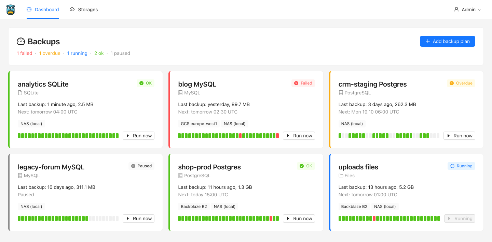
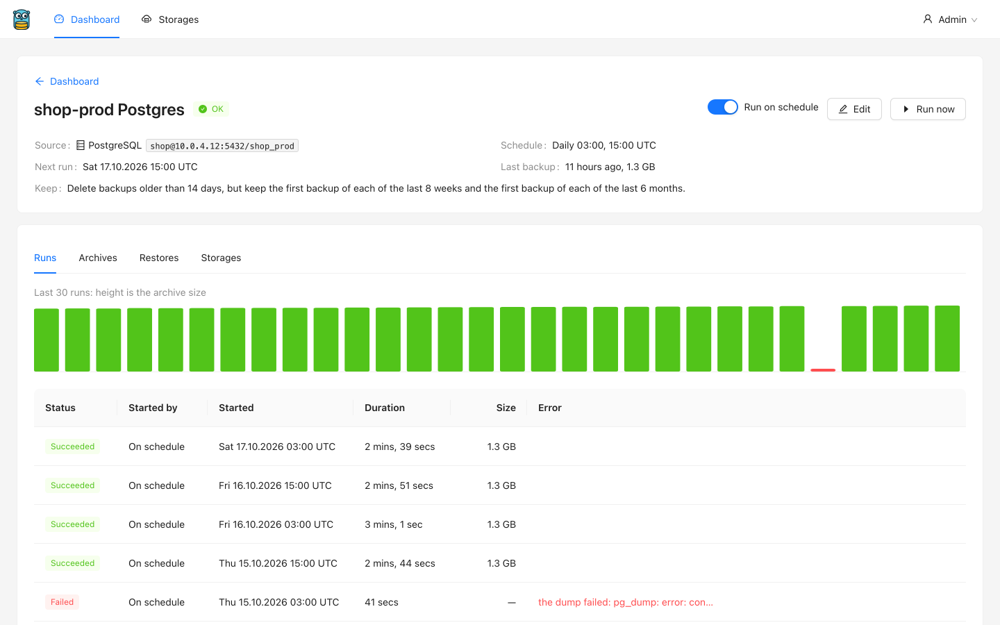
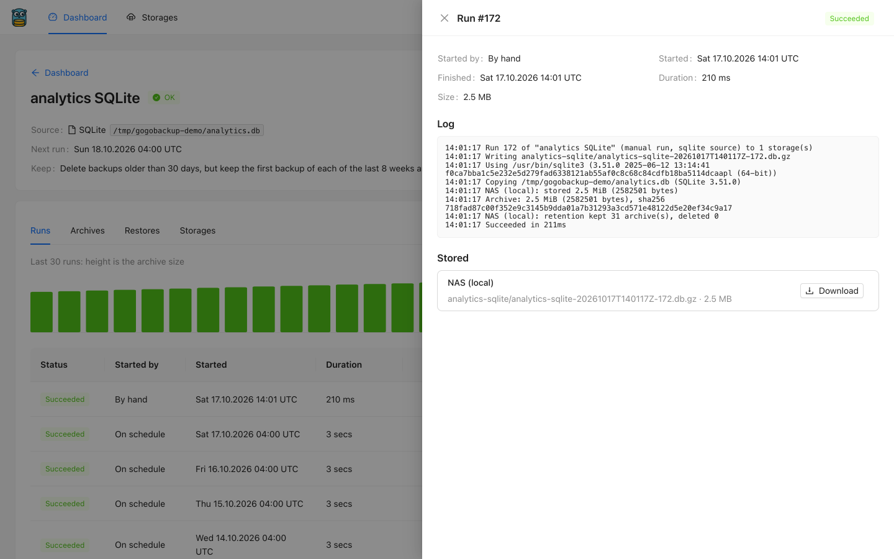
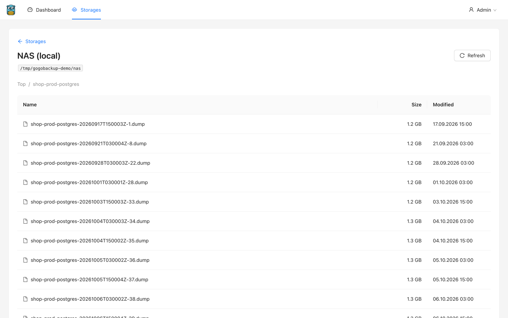
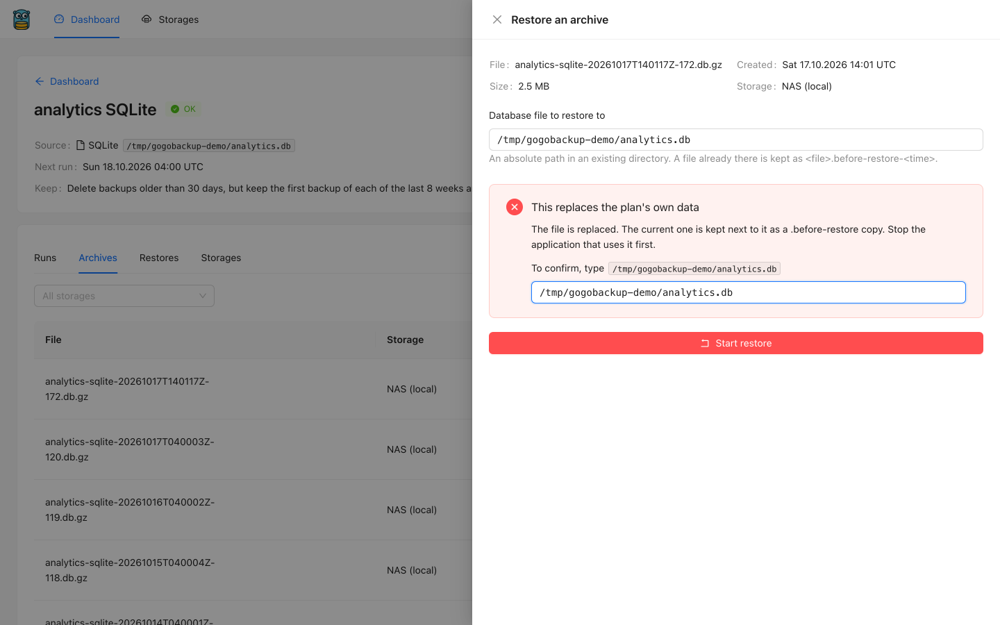
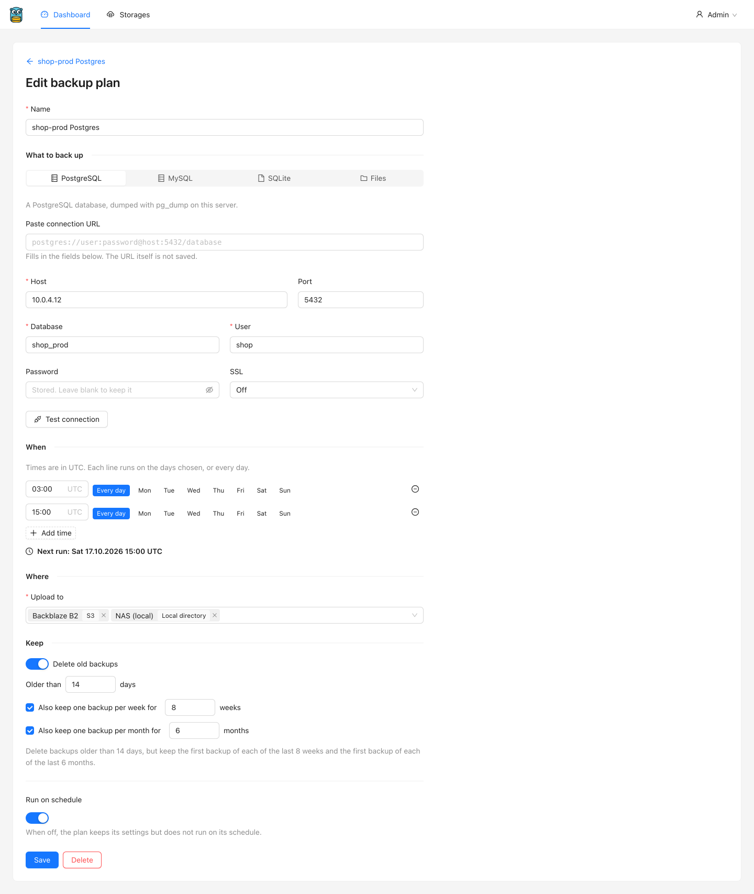
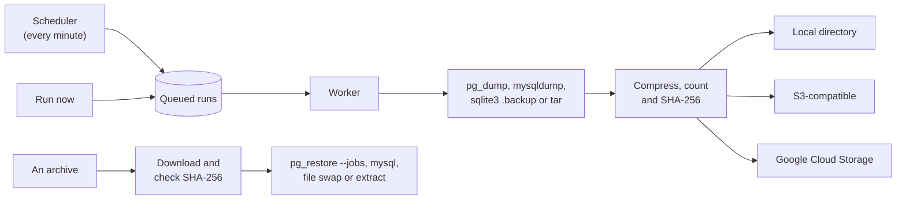

<p align="center">
  <picture>
    <source media="(prefers-color-scheme: dark)" srcset="docs/images/logo-wordmark-dark.svg">
    
  </picture>
</p>

<p align="center">
  Self-hosted backups for Postgres, MySQL, SQLite and files, with schedules, retention, a dashboard and restore.
</p>

<p align="center">
  <a href="https://github.com/nicklasos/gogobackup/actions/workflows/ci.yml"></a>
  
  
  
  <a href="LICENSE"></a>
  
</p>



Gogobackup is a web app that runs on your server. It backs up the Postgres, MySQL and SQLite databases and
the folders on that server to a local directory, S3-compatible storage or Google Cloud Storage. It runs each
backup plan on a schedule, deletes old archives by your retention rules, and restores an archive when you ask.

## Why

One server often runs many projects, development and production side by side. A shell script and a cron line
per project works until there are a dozen of them, each copied from the last and slightly different, and
nobody notices when one stops working. Gogobackup replaces those scripts with a web page. You add a storage
once and a backup plan per database or folder, and the dashboard shows which plans failed or missed a run.

## Features

- **Four kinds of source.** Postgres with `pg_dump` in custom format, restored by `pg_restore --jobs` in
  parallel. MySQL and MariaDB with `mysqldump`. SQLite with `sqlite3 .backup`, which reads a consistent
  snapshot of a live database. Folders as `tar.gz`, with exclude patterns.
- **Three kinds of storage.** A local directory, Amazon S3 or any S3-compatible service (MinIO,
  Cloudflare R2, Backblaze B2, Wasabi), and Google Cloud Storage. Each has a connection test and a browser.
- **Schedules in UTC.** A plan has as many times a day as you want, each on every day or on chosen weekdays.
  The editor shows the next run as you type.
- **Retention.** Delete archives older than N days, but keep the first archive of each of the last N weeks
  and N months. The newest archive is never deleted.
- **One dump, every storage.** The dump streams through compression and SHA-256 to all of the plan's
  storages at once, with no temporary file. A storage that fails is dropped and the others finish.
- **A dashboard.** One card per plan, coloured by its health (ok, failed, overdue, running, paused), with
  the last backup, the next run and a strip of the last 30 days.
- **Live logs.** A run's log, with the dump program's own output, updates every 2 seconds while it runs.
- **Restore from the browser.** Restore into the plan's own database, file or folders, or into another
  database or directory. Restoring over the plan's own data needs you to type its name or path.
- **Downloads.** Any archive downloads from the browser, streamed straight from its storage.
- **Email on failure.** A failed run or restore emails every admin the error, the last 40 log lines and a link.
- **Encrypted credentials.** Storage keys and database passwords are encrypted with AES-256-GCM under
  `ENCRYPTION_KEY`. The API never returns them, and dump programs never get a password in their arguments.
- **It backs itself up.** Every deploy makes sure a plan backs up Gogobackup's own database.
- **Small footprint.** A Go API and one SQLite file. No Redis and no database server. nginx serves the
  admin panel's static build.

## Screenshots

<table>
  <tr>
    <td width="50%"></td>
    <td width="50%"></td>
  </tr>
  <tr>
    <td>A plan's runs. Bar height is the archive size, and a red bar is a failed run.</td>
    <td>A run's log, written while the run goes on.</td>
  </tr>
  <tr>
    <td></td>
    <td></td>
  </tr>
  <tr>
    <td>The storage browser.</td>
    <td>A restore over the plan's own database asks you to type its path.</td>
  </tr>
  <tr>
    <td align="center"></td>
    <td align="center"></td>
  </tr>
  <tr>
    <td>The plan editor.</td>
    <td>The dashboard on a phone.</td>
  </tr>
</table>

## How it works



The scheduler runs inside the API process and queues the latest due slot of each plan once a minute. After
downtime it runs the latest missed slot once, not one run per missed slot. The worker runs a few jobs at once
(`RUNNER_CONCURRENCY`) and never two jobs of the same plan, so a backup never reads a half-restored database.
After a successful run, retention deletes old archives from each storage. A restore downloads the archive and
checks its size and SHA-256 before it writes anything.

## Run it locally

You need Go 1.25 or newer, Node.js 22 or newer, and Make. To back up a database, its dump program must be
on your `PATH` (see [Requirements on the server](#requirements-on-the-server)).

```bash
git clone https://github.com/nicklasos/gogobackup.git && cd gogobackup
cp backend/.env.example backend/.env
cp frontend/.env.example frontend/.env

make cli migrate up             # creates backend/data/gogobackup.db
make seed                       # admin@example.com / password123, a local storage and one plan

cd backend && make run          # API on http://localhost:8181
cd frontend && npm install && npm run dev   # from the root, in a second terminal: http://localhost:5173
```

Sign in at http://localhost:5173 as `admin@example.com` with the password `password123`. The seed adds the
storage "Local backups" at `backend/data/backups` and the plan "Gogobackup database", which backs up the
development database. Press **Run now** on its card to see a run. The API documentation is at
http://localhost:8181/swagger/index.html.

`make dev` in `backend/` reloads the API on every change (`make air-install` once). With `APP_DEBUG=true`, as in
`.env.example`, emails go to the API's log. `make up` starts Mailpit in Docker if you would rather read them in
a mailbox at http://localhost:8025.

## Deploy to a server

The Ansible playbooks in [deploy/](deploy) set up a fresh Ubuntu 22.04 or 24.04 server. From the repository
root:

```bash
make deploy-setup                                                  # Ansible collections, once
cp deploy/inventory/hosts.example.yml deploy/inventory/hosts.yml   # the server's address and SSH user
cp deploy/secrets.example.yml deploy/group_vars/all/secrets.yml    # jwt_secret and encryption_key
$EDITOR deploy/group_vars/all/main.yml                             # app_name, domain, repo_url, tls_mode
make provision
```

Generate `jwt_secret` with `openssl rand -hex 32` and `encryption_key` with `openssl rand -base64 32`.
`make provision` installs Go, Node.js, nginx, supervisor, a firewall and the dump programs (`sqlite3`,
`pg_dump` and `pg_restore`, `mysqldump` and `mysql`). It then builds the API and the admin panel, gets a TLS
certificate, and creates the plan "Gogobackup itself", which backs up Gogobackup's own database to
`shared/backups/` every night. Release new code with `make deploy-remote`.

> [!WARNING]
> Keep a copy of `encryption_key` somewhere other than the server. The storage keys and database passwords
> in a restored database cannot be decrypted without it. Add an S3 or GCS storage to "Gogobackup itself" too,
> because a local copy is lost with the server's disk.

A server that already runs other applications gets `make install-remote` instead, which installs no
packages. [deploy/README.md](deploy/README.md) covers both, the TLS modes and what goes where on the server.
[deploy/MANUAL_INSTALL.md](deploy/MANUAL_INSTALL.md) has the same install as commands to type by hand.

## Configuration

The API reads `backend/.env`. These are the settings you are most likely to change. The full list, with
comments, is in [backend/.env.example](backend/.env.example).

| Variable | Default | What it does |
|---|---|---|
| `DATABASE_PATH` | `./data/gogobackup.db` | Gogobackup's own SQLite file. |
| `JWT_SECRET` | none, required | Signs sign-in tokens. With `APP_ENV=production`, at least 32 characters. |
| `ENCRYPTION_KEY` | a public development key, with a warning | 32 random bytes in base64 that encrypt storage keys and database passwords. Required with `APP_ENV=production`. |
| `ENABLE_SCHEDULER` | `true` | Runs the scheduler and the worker in the API process. Set `false` to run them in `cmd/cron` instead. |
| `RUNNER_CONCURRENCY` | `2` | How many backups and restores run at once. A plan runs one job at a time. |
| `WORK_DIR` | `./data/work` | Where restores download archives. It needs room for the largest Postgres archive. |
| `RESTORE_JOBS` | `4` | Parallel jobs of `pg_restore`. |
| `FRONTEND_URL` | `http://localhost:5173` | The admin panel's address, for the links in emails. |
| `PORT` | `8181` | The API's port. |
| `MAIL_HOST`, `MAIL_PORT`, `MAIL_SCHEME`, `MAIL_USERNAME`, `MAIL_PASSWORD`, `MAIL_FROM_ADDRESS`, `MAIL_FROM_NAME` | port `587`, scheme `smtp` | SMTP for failure emails. `MAIL_SCHEME` is `smtp` (STARTTLS), `smtps` or `none`. |
| `APP_DEBUG` | `false` | With `true`, emails are written to the log instead of sent. |

## Requirements on the server

Dump programs run on the server Gogobackup runs on, as the API's user.

- **Postgres.** `pg_dump` and `pg_restore` of at least the database server's major version, because `pg_dump`
  refuses to dump a newer server. Ubuntu 24.04 ships version 16, so a Postgres 17 server needs the client from the
  PostgreSQL apt repository ([deploy/README.md](deploy/README.md#dump-tools) has the commands).
- **MySQL and MariaDB.** `mysqldump`, and `mysql` for restores.
- **SQLite.** `sqlite3`.
- **Folders.** Nothing. Gogobackup writes and reads `tar.gz` itself.

A plan's **Test connection** button shows the version of the dump program it finds and, for databases, the
server's version.

## Development

`make test` from the root runs everything CI runs except the deploy checks:

- The backend's Go unit and integration tests. Each test gets its own SQLite file. The tests that dump and
  restore real Postgres and MySQL servers run when `TEST_POSTGRES_URL` and `TEST_MYSQL_URL` are set.
- The frontend's typecheck, ESLint, unit tests, and the Playwright suite against a real API.

Run `make playwright-browsers` in `frontend/` once before the first run.

| Folder | What it is |
|---|---|
| [backend/](backend) | The Go API: Gin, SQLite through sqlc, the scheduler, the worker and the storage drivers. |
| [frontend/](frontend) | The admin panel: React, TypeScript, Ant Design and TanStack Query. |
| [deploy/](deploy) | Ansible playbooks to provision a server, install on an existing one and release. |
| [docs/](docs) | The plan the service was built from, and the images in this README. |
| [scripts/](scripts) | The script that regenerates these screenshots, and the one that renders the logo. |

[AGENTS.md](AGENTS.md) is the guide for contributors and coding agents. Each folder has its own `AGENTS.md`
or README with its conventions.

## Status

CI dumps and restores real Postgres 17 and MySQL 8 servers on every pull request and every push to `main`. The S3 and GCS drivers are tested
against in-process fakes (gofakes3 and fake-gcs-server), not real buckets. Gogobackup has not been
battle-tested in production yet, and the Ansible playbooks have not yet run against a real server, so try
your first deploy on a server you can throw away.

## Credits

Gogobackup is built on [Gogokit](https://github.com/nicklasos/gogokit), a Go API and React admin panel
starter kit.

The Go gopher was designed by Renée French and is licensed under
[CC BY 4.0](https://creativecommons.org/licenses/by/4.0/). The Gogobackup gopher is an original drawing of
that character.

## License

[WTFPL](LICENSE).
